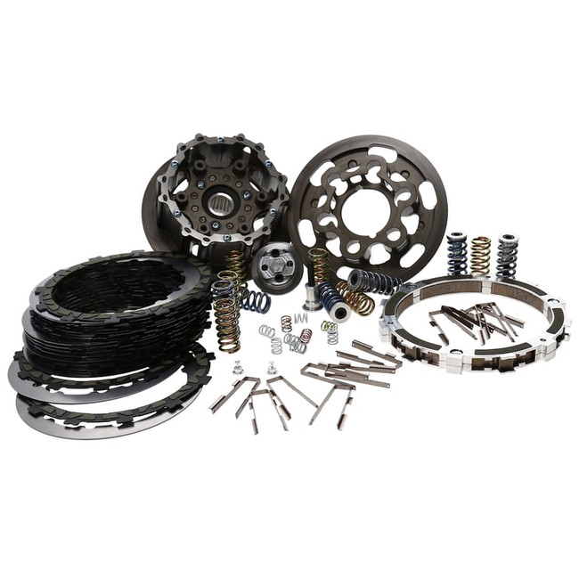

# Rekluse RadiusCX auto clutch with upgraded basket

[Home](../README.md) · [All parts A–Z](../PARTS_INDEX.md) · [System](../systems/primary.md)

*Photo: Prior inventory product-family reference: RadiusCX basket kit. Exact installed kit/basket SKU remains unconfirmed.*

| Field | Record |
| --- | --- |
| Status | Installed — owner reported |
| Quantity | 1  |
| Part number | Not confirmed |
| Order / source | Owner-confirmed installed equipment |
| Documentation checked | 2026-10-23 |

## Product and installation documents

- [Product reference](https://www.rekluse.com/product/auto-clutches/radiuscx/radiuscx-clutches/radiuscx-harley-davidson-m8-hydraulic-2017/)
- [Prior inventory reference (may illustrate product family)](https://www.rekluse.com/product/auto-clutches/radiuscx/radiuscx-clutches/radiuscx-basket-harley-davidson-m8-hydraulic-2017/)
- [Prior inventory reference (may illustrate product family)](https://imagedelivery.net/IaKGQXu3HHhBuEAF7BOmlg/580df1ba-b256-4e8f-3f10-f6579c0ff400/public)
- [RadiusCX M8 hydraulic install guide](https://www.rekluse.com/wp-content/uploads/2025/08/RMS-7915005-InstallGuide.pdf) — Conditional: use only if installed kit is RMS-7915005
- [RadiusCX dynamometer procedure](https://www.rekluse.com/wp-content/uploads/2025/08/RMS-7915005-DynoSheet.pdf) — Conditional: RMS-7915005
- [RadiusCX rider guide](https://www.rekluse.com/wp-content/uploads/2025/08/RMS-7915005-RidersGuide.pdf) — Conditional: RMS-7915005
- [Downloaded PDF copy: RadiusCX M8 hydraulic install guide](../manuals/rekluse-auto-clutch-47de7b43.pdf)
- [Downloaded PDF copy: RadiusCX dynamometer procedure](../manuals/rekluse-auto-clutch-2f69571a.pdf)
- [Downloaded PDF copy: RadiusCX rider guide](../manuals/rekluse-auto-clutch-3ddcda98.pdf)

## Build notes

- Oct 20 master inventory confirms RadiusCX family, upgraded basket and installed slave; six blue spare springs on hand. Exact kit and basket SKUs are unrecorded.
- Official catalog maps 2017–2020 M8 hydraulic RadiusCX to RMS-7915005; retain as a catalog match until matched against the box or invoice.
- Photo shows official RMS-7915005 reference kit.
- Official component fiche: https://www.rekluse.com/product-fiche/ .

## Kit / assembly itemization

Components are grouped with this product. Separately indexed equipment and assembly references are not additional purchases. Read each row’s inclusion note.

| Included component | Quantity | Part number | Reference | Inclusion / identification note |
| --- | --- | --- | --- | --- |
| EXP auto clutch disk | 1 | Not published | [Kit/manual parts reference](https://www.rekluse.com/wp-content/uploads/2025/08/RMS-7915005-InstallGuide.pdf) | Manufacturer part-list reference; standalone sale link not verified |
| Core billet clutch hub | 1 | Not published | [Kit/manual parts reference](https://www.rekluse.com/wp-content/uploads/2025/08/RMS-7915005-InstallGuide.pdf) | Manufacturer part-list reference; standalone sale link not verified |
| Core billet pressure plate | 1 | Not published | [Kit/manual parts reference](https://www.rekluse.com/wp-content/uploads/2025/08/RMS-7915005-InstallGuide.pdf) | Manufacturer part-list reference; standalone sale link not verified |
| TorqDrive friction disks and drive plates | Set | Not published | [Kit/manual parts reference](https://www.rekluse.com/wp-content/uploads/2025/08/RMS-7915005-InstallGuide.pdf) | Manufacturer part-list reference; standalone sale link not verified |
| Coil clutch springs | 6 | Not published | [Kit/manual parts reference](https://www.rekluse.com/wp-content/uploads/2025/08/RMS-7915005-InstallGuide.pdf) | Manufacturer part-list reference; standalone sale link not verified |
| Basket sleeves | Set | Not published | [Kit/manual parts reference](https://www.rekluse.com/wp-content/uploads/2025/08/RMS-7915005-InstallGuide.pdf) | Manufacturer part-list reference; standalone sale link not verified |
| Upgraded clutch basket, exact brand/model/SKU unrecorded | 1 | Not published | Confirmed existing assembly component from Oct 20 master; not claimed included with base RadiusCX kit | Confirmed existing assembly component from Oct 20 master; not claimed included with base RadiusCX kit |
| Blue spare Rekluse springs | 6 | Not published | [Kit/manual parts reference](https://www.rekluse.com/product-fiche/) | Separate on-hand spares confirmed Oct 20; exact spring SKU unrecorded |

Existing owner-confirmed clutch assembly and reference kit details; hydraulic slave and six spare springs are separately indexed and not additional unrecorded purchases.

**Kit documentation gap:** RadiusCX family and upgraded basket are owner-confirmed. Exact kit/basket SKUs and installed spring configuration remain unidentified. Listed assembly items are not all asserted to come in one purchased box.

## Evidence

- Owner conversation history; installed state reported by owner.
- Prior project inventory: Street_Glide_Master_Parts.xlsx, October 20, 2026, worksheet row 22.

## Builder record

- [ ] Received and box label matched
- [ ] Hardware and instructions present
- [ ] Installed / retained / superseded decision recorded
- [ ] Function checked

Installed date: __________  Technician: __________

Notes: ____________________________________________________
