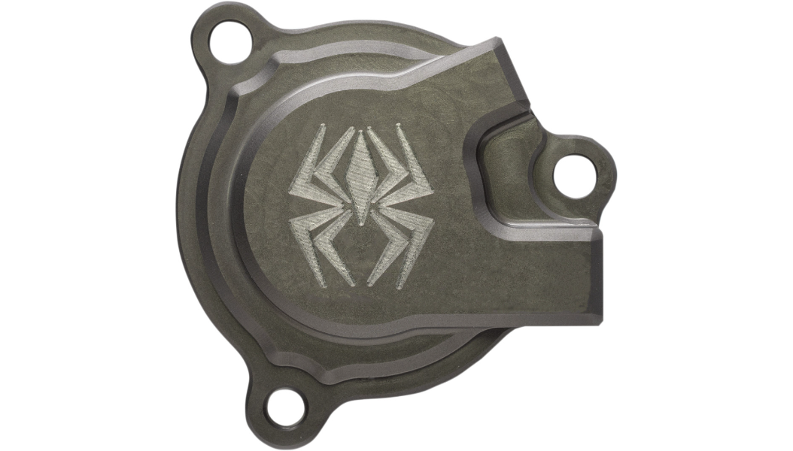

# Rekluse M8 hydraulic clutch slave cylinder

[All parts](../README.md) · [System](../systems/primary.md)

| Field | Record |
| --- | --- |
| Status | Installed — owner reported |
| Quantity | 1  |
| Part number | RMS-2415050 (catalog match; purchase SKU not recovered) |
| Part-number evidence | Catalog match to owner-provided M8 product link; purchase SKU not recovered |
| Order / source | Owner-confirmed installed equipment |
| Documentation checked | 2026-10-23 |

## Product and installation documents

- [Product reference](https://www.rekluse.com/product/clutch-accessories/manual-slave-cylinder-kit/billet-slave-cyl-harley-davidsonson-m8/)
- [Prior inventory reference (may illustrate product family)](https://www.rekluse.com/product/auto-clutches/radiuscx/radiuscx-clutches/radiuscx-basket-harley-davidson-m8-hydraulic-2017/)
- [Prior inventory reference (may illustrate product family)](https://imagedelivery.net/IaKGQXu3HHhBuEAF7BOmlg/580df1ba-b256-4e8f-3f10-f6579c0ff400/public)
- [M8 slave installation manual](https://www.rekluse.com/wp-content/uploads/2025/08/RMS-2415050.pdf) — Exact product family
- [Downloaded PDF copy: M8 slave installation manual](../manuals/rekluse-slave-6997e396.pdf)

## Build notes

- Owner supplied J&P Cycles M8 Touring/Softail product link in conversation. Official M8 part is RMS-2415050.
- Photo from Shop catalog listing with RMS-2415050 exact title.
- Instructions require checking fluid specification; listed manual uses DOT 4. New master cylinder selection must be assessed with this installed slave.

## Kit / assembly itemization

Components are grouped with this product. Separately indexed equipment and assembly references are not additional purchases. Read each row’s inclusion note.

| Included component | Quantity | Part number | Reference | Inclusion / identification note |
| --- | --- | --- | --- | --- |
| Assembled slave cylinder | 1 | Not published | [Kit/manual parts reference](https://www.rekluse.com/wp-content/uploads/2025/08/RMS-2415050.pdf) | Manufacturer part-list reference; standalone sale link not verified |
| Bleed tube | 1 | Not published | [Kit/manual parts reference](https://www.rekluse.com/wp-content/uploads/2025/08/RMS-2415050.pdf) | Manufacturer part-list reference; standalone sale link not verified |

**Kit documentation gap:** Some internal parts have only an illustrated kit/manual reference; separate retail listings or service SKUs were not verified. Do not treat a parent-kit link as a standalone component offer.

## Evidence

- Owner conversation history; installed state reported by owner.
- Prior project inventory: Street_Glide_Master_Parts.xlsx, October 20, 2026, worksheet row 22.

## Builder record

- [ ] Received and box label matched
- [ ] Hardware and instructions present
- [ ] Installed / retained / superseded decision recorded
- [ ] Function checked

Installed date: __________  Technician: __________

Notes: ____________________________________________________
