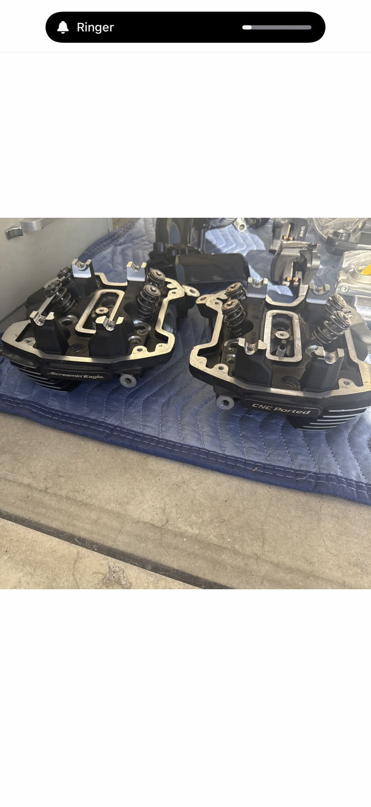

# Gen1 M8 Screamin Eagle Stage IV Oil-Cooled CNC Ported Cylinder Heads

[All parts](../README.md) · [System](../systems/engine.md)

*Photo: Owner-provided photograph of purchased heads, preserved in the October 20 inventory.*

| Field | Record |
| --- | --- |
| Status | Delivered |
| Quantity | 2 heads (one purchased pair) |
| Part number | Castings 16500520 / 16500526 |
| Part-number evidence | Owner-confirmed casting numbers; complete assembly SKU unverified |
| Order / source | eBay 01-15303-18563 |
| Order date | 2026-10-11 |
| Variant | Pair per owner; item 327395332837; delivered October 15. |
| Documentation checked | 2026-10-23 |

## Product and installation documents

- [Ordered product listing](https://www.ebay.com/itm/327395332837)
- [Manufacturer product](https://www.harley-davidson.com/us/en/shop/screamin-eagle-milwaukee-eight-engine-cnc-ported-cylinder-heads/p/16500512)
- [Harley-Davidson J06401: M8 Screamin Eagle Pro CNC Ported Cylinder Heads (2021-12-13)](https://serviceinfo.harley-davidson.com/sip/service/document/1874975677612623235?locale=en_GB) — Manufacturer installation instructions
- [J06401 printable instructions](https://serviceinfo.harley-davidson.com/sip/service/document-pdf-print/1874975677612623235/293420/J06401_1018823_en_US.xml) — Manufacturer installation instructions

## Build notes

- Pair per owner; item 327395332837; delivered October 15.
- Castings 16500520 / 16500526 are confirmed by the prior owner inventory; complete assembly SKU and the currently installed valves/springs remain unverified. Catalog kit 16500512 is a related oil/air-cooled family reference, not a verified identification of this used pair.
- The eBay item URL now redirects into a product catalog page; do not infer casting numbers from the redirected page. Use the order photograph already preserved in the inventory and physically identify the delivered heads.
- J06401 says the stock springs supplied with its listed head kits support .540-inch maximum cam lift. The selected S&S 550C is .550-inch lift. The delivered used heads may have different springs, so the builder must identify them and measure the assembled valvetrain. The Power Pack includes a high-lift spring kit; select and verify the final spring arrangement with installed height, coil-bind, retainer-to-guide/seal and piston-to-valve checks.
- Follow the head, piston, cam and actual head-fastener instructions together. Do not mix stock fastener tightening instructions with the Guardian head-bolt instructions.

## Evidence

- Gmail message 1a12e6f312148933; order reference eBay 01-15303-18563
- Gmail message 1a14097ce759728a; order reference eBay 01-15303-18563
- Public source: https://www.ebay.com/itm/327395332837
- Public source: https://serviceinfo.harley-davidson.com/sip/service/document/1874975677612623235?locale=en_GB
- Public source: https://www.harley-davidson.com/us/en/shop/screamin-eagle-milwaukee-eight-engine-cnc-ported-cylinder-heads/p/16500512
- Public source: https://www.sscycle.com/products/550c-chain-drive-camshaft-kit-for-2017-up-m8-models/
- Public source: https://www.sscycle.com/products/heavy-duty-valve-spring-kit-for-2017-up-m8-models/
- Prior project inventory: Street_Glide_Master_Parts.xlsx, October 20, 2026, worksheet row 7.

## Builder record

- [ ] Received and box label matched
- [ ] Hardware and instructions present
- [ ] Installed / retained / superseded decision recorded
- [ ] Function checked

Installed date: __________  Technician: __________

Notes: ____________________________________________________
