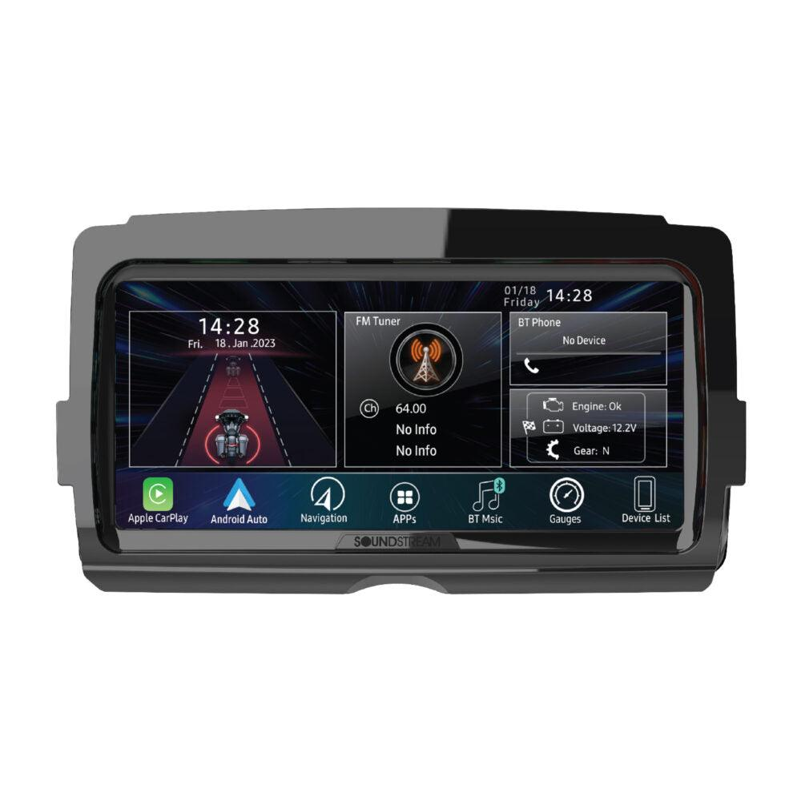

# Soundstream Reserve V2 head unit

[Home](../README.md) · [All parts A–Z](../PARTS_INDEX.md) · [System](../systems/audio.md)

| Field | Record |
| --- | --- |
| Status | Installed — owner reported |
| Quantity | 1  |
| Part number | V2 (owner called Reserve 2) |
| Part-number evidence | Manufacturer catalog match; verify received part label |
| Order / source | Owner-confirmed installed equipment |
| Documentation checked | 2026-10-23 |

## Product and installation documents

- [Product reference](https://motorcycleaudio.com/products/v2-headunit)
- [Prior inventory reference (may illustrate product family)](https://www.crutchfield.com/p_530HDHUV2/Soundstream-Reserve-V2.html)
- [V2 owner manual, installation and wiring](https://motorcycleaudio.com/cdn/shop/files/V2_Owner_Manual.pdf) — Exact product family
- [Downloaded PDF copy: V2 owner manual, installation and wiring](../manuals/soundstream-v2-dc1891a9.pdf)

## Build notes

- Match model label to V2 before firmware changes; WHD and older HDHU radios use different files.
- Factory mount and screws, USB cable and radio antenna connection are retained per manual.
- Existing iDataLink Maestro confirmed by October 20 inventory and October 15 controls note; exact interface model is unrecorded. Retain both V2 and AIO-6 LTE.

## Kit / assembly itemization

Components are grouped with this product. Separately indexed equipment and assembly references are not additional purchases. Read each row’s inclusion note.

| Included component | Quantity | Part number | Reference | Inclusion / identification note |
| --- | --- | --- | --- | --- |
| V2 radio | 1 | Not published | [Kit/manual parts reference](https://motorcycleaudio.com/cdn/shop/files/V2_Owner_Manual.pdf) | Manufacturer part-list reference; standalone sale link not verified |
| Main harness / Maestro-ready connection harness | 1 | Not published | [Kit/manual parts reference](https://motorcycleaudio.com/cdn/shop/files/V2_Owner_Manual.pdf) | Manufacturer part-list reference; standalone sale link not verified |
| RCA audio output harness | 1 | Not published | [Kit/manual parts reference](https://motorcycleaudio.com/cdn/shop/files/V2_Owner_Manual.pdf) | Manufacturer part-list reference; standalone sale link not verified |
| GPS antenna cable | 1 | Not published | [Kit/manual parts reference](https://motorcycleaudio.com/cdn/shop/files/V2_Owner_Manual.pdf) | Manufacturer part-list reference; standalone sale link not verified |
| Bluetooth calling microphone | 1 | Not published | [Kit/manual parts reference](https://motorcycleaudio.com/cdn/shop/files/V2_Owner_Manual.pdf) | Manufacturer part-list reference; standalone sale link not verified |

**Kit documentation gap:** Some internal parts have only an illustrated kit/manual reference; separate retail listings or service SKUs were not verified. Do not treat a parent-kit link as a standalone component offer.

## Evidence

- Owner conversation history; installed state reported by owner.
- Prior project inventory: Street_Glide_Master_Parts.xlsx, October 20, 2026, worksheet row 34.

## Builder record

- [ ] Received and box label matched
- [ ] Hardware and instructions present
- [ ] Installed / retained / superseded decision recorded
- [ ] Function checked

Installed date: __________  Technician: __________

Notes: ____________________________________________________
