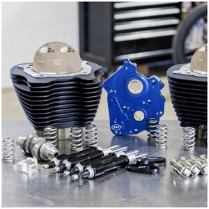

# 129" Power Pack for 107" Milwaukee-Eight 2017-2023

[All parts](../README.md) · [System](../systems/engine.md)

*Photo: Product/catalog image; inspect supplied hardware and finish against order description.*

| Field | Record |
| --- | --- |
| Status | Shipped |
| Quantity | 1  |
| Part number | 310-1226 |
| Part-number evidence | Exact selection in October 20 owner inventory; corroborated manufacturer catalog |
| Order / source | Cycle Gear 58815070 |
| Order date | 2026-10-11 |
| Variant | Chain drive cam; black without silver fins; black pushrods. |
| Documentation checked | 2026-10-23 |

## Product and installation documents

- [Product reference](https://www.cyclegear.com/parts/ss-cycle-129-power-pack-for-harley-with-107-milwau-1)
- [Manufacturer product](https://www.sscycle.com/shop-by-category/performance-kits/129-132-power-package/)
- [Prior inventory reference (may illustrate product family)](https://teamdreamrides.com/products/s-s-cycle-129-power-package-engine-performance-kit-for-m8-chain-drive-oil-cooled-part-310-1226)
- [S&S 4.320-inch bore cylinder and piston kits, 510-0844A (2026 revision)](https://www.sscycle.com/content/document_center/Instruction_Sheets/510-0844A%204-320%E2%80%9D%20Bore%20Cylinder%20and%20Piston%20Kits%20M8%20Models%20.pdf) — Manufacturer installation instructions
- [S&S 4.320-inch bore cylinder and piston kits, 510-0844 (2023 revision)](https://www.sscycle.com/content/document_center/Instruction_Sheets/510-0844-4-320-bore-cylinder-and-piston-kits-m8-models-.pdf) — Manufacturer installation instructions
- [550C cam instructions: 510-0467-chain-drive-cams-m8.pdf](https://www.sscycle.com/products/550c-chain-drive-camshaft-kit-for-2017-up-m8-models/) — Download listed in manufacturer product page
- [Billet cam support plate instructions, 510-0582](https://www.sscycle.com/content/document_center/Instruction_Sheets/510-0582-cam-support-plate-for-m8-1-.pdf) — Manufacturer installation instructions
- [Oil pump instructions: 510-0597-oil-pumps-for-m8.pdf](https://www.sscycle.com/products/oil-pump-for-2017-up-m8-oil-cooled-models/) — Download listed in manufacturer product page
- [Adjustable pushrods: 106-6046-adjustable-pushrods-and-hl2t.pdf](https://www.sscycle.com/products/quickee-pushrods-with-gloss-black-covers-for-2017-up-m8-models/) — Download listed in manufacturer product page
- [Valve spring instructions: 510-0559-valve-springs-m8.pdf](https://www.sscycle.com/products/heavy-duty-valve-spring-kit-for-2017-up-m8-models/) — Download listed in manufacturer product page
- [Tappet cuff instructions: 510-0575-tappet-cuffs-for-m8.pdf](https://www.sscycle.com/products/tappet-cuffs-for-2017-up-m8-models/) — Download listed in manufacturer product page

## Build notes

- Chain drive cam; black without silver fins; black pushrods.
- Ordered variant is chain drive, no silver/highlighted cylinder fins, black pushrod covers. Catalog match is 310-1226; 310-1227 is not this variant.
- Get Lowered lists S&S 900-1006 head bolts as separately required by this Power Pack. The separately ordered Top End Guardian kit already lists 900-1006 head bolts: reconcile those boxes before adding another set.
- Power Pack and Guardian descriptions do not establish duplicate principal components. Guardian rocker studs are distinct from the separately purchased cylinder studs.
- The used Screamin Eagle heads change the final engine combination. Measure actual chamber/piston/deck/gasket relationship and valve clearances; the advertised baseline compression ratio is not a verified ratio for this assembled engine.
- S&S 550C has .550-inch valve lift and requires high-lift valve springs. Compare supplied springs and actual used-head spring hardware before assembly; see head entry.

## Kit / assembly itemization

Components are grouped with this product. Separately indexed equipment and assembly references are not additional purchases. Read each row’s inclusion note.

| Included component | Quantity | Part number | Reference | Inclusion / identification note |
| --- | --- | --- | --- | --- |
| 4.320-inch bore cylinders, black without highlighted fins | 2 | Not published | [Kit/manual parts reference](https://www.sscycle.com/shop-by-category/performance-kits/129-and-132-cylinder-piston-kits/) | 129-inch configuration for original 107-inch engine; individual cylinder SKU not verified. |
| Forged pistons and associated ring/pin package | one matched set | Not published | [Kit/manual parts reference](https://www.sscycle.com/shop-by-category/performance-kits/129-and-132-cylinder-piston-kits/) | Exact piston/ring/pin component SKUs not established; verify physical package and supplied bill of materials. |
| 550C chain-drive camshaft kit | 1 | 330-0643 | [Kit/manual parts reference](https://www.sscycle.com/products/550c-chain-drive-camshaft-kit-for-2017-up-m8-models/) | Catalog component match; confirm package labels. This is chain-drive, not gear-drive. |
| Billet oil-cooled M8 oil pump | 1 | 310-0959A | [Kit/manual parts reference](https://www.sscycle.com/products/oil-pump-for-2017-up-m8-oil-cooled-models/) | Current standalone catalog SKU; kit may carry an earlier revision label. |
| Billet cam support plate | 1 | 310-0939A | [Kit/manual parts reference](https://www.sscycle.com/content/document_center/Instruction_Sheets/510-0582-cam-support-plate-for-m8-1-.pdf) | Current catalog SKU; linked installation document identifies assembly. Separate product page not verified. |
| Quickee adjustable pushrods with black covers/keepers | one set | 930-0137 | [Kit/manual parts reference](https://www.sscycle.com/products/quickee-pushrods-with-gloss-black-covers-for-2017-up-m8-models/) | Standalone catalog match to black-covered kit contents; reconcile physical packet. |
| Hydraulic tappets | one set | Not published | [Parent product / kit reference](https://www.sscycle.com/shop-by-category/performance-kits/129-132-power-package/) | Included by Power Pack description; exact tappet sub-SKU not verified. Do not substitute a tappet SKU merely recommended by a cam product page. |
| Tappet cuffs | one set | 330-0655 | [Kit/manual parts reference](https://www.sscycle.com/products/tappet-cuffs-for-2017-up-m8-models/) |  |
| High-lift conical valve spring kit with collars, keepers and valve seals | one set | 900-0958 | [Kit/manual parts reference](https://www.sscycle.com/products/heavy-duty-valve-spring-kit-for-2017-up-m8-models/) | Spring kit family rated up to .605-inch lift; actual head geometry still requires measurement. |
| Cam chain tensioner | 1 | 330-0737 | [Kit/manual parts reference](https://www.sscycle.com/products/cam-chain-tensioner-for-2017-up-m8-models/) | Engine cam-chain component; unrelated to the primary-drive chain tensioner. |
| Assembly gaskets and supplied installation hardware | one kit | Not published | [Parent product / kit reference](https://www.sscycle.com/shop-by-category/performance-kits/129-132-power-package/) | Individual gasket/fastener SKUs and exact counts not verified; use packing list. |
| Cam cover badge | 1 | Not published | [Parent product / kit reference](https://www.sscycle.com/shop-by-category/performance-kits/129-132-power-package/) | Included by kit description; separate item SKU not verified. |

**Kit documentation gap:** Some internal parts have only an illustrated kit/manual reference; separate retail listings or service SKUs were not verified. Do not treat a parent-kit link as a standalone component offer.

## Evidence

- Gmail message 1a12c7e9fe57e72f; order reference Cycle Gear 58815070
- Public source: https://www.sscycle.com/shop-by-category/performance-kits/129-132-power-package/
- Public source: https://www.cyclegear.com/parts/ss-cycle-129-power-pack-for-harley-with-107-milwau-1
- Public source: https://www.getlowered.com/s-s-129-power-pack-chain-drive-oil-cooled-kit-for-107-harley-m8/
- Public source: https://www.sscycle.com/products/550c-chain-drive-camshaft-kit-for-2017-up-m8-models/
- Public source: https://www.sscycle.com/products/heavy-duty-valve-spring-kit-for-2017-up-m8-models/
- Prior project inventory: Street_Glide_Master_Parts.xlsx, October 20, 2026, worksheet row 6.

## Builder record

- [ ] Received and box label matched
- [ ] Hardware and instructions present
- [ ] Installed / retained / superseded decision recorded
- [ ] Function checked

Installed date: __________  Technician: __________

Notes: ____________________________________________________
