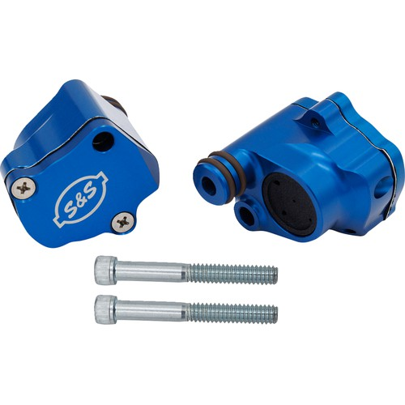

# Billet Head Breather Kit

[Home](../README.md) · [All parts A–Z](../PARTS_INDEX.md) · [System](../systems/engine.md)

*Photo: Product/catalog image; inspect supplied hardware and finish against order description.*

| Field | Record |
| --- | --- |
| Status | Shipped |
| Quantity | 1  |
| Part number | 900-1186 |
| Part-number evidence | Catalog match to ordered description; order email does not print this SKU |
| Order / source | Parts Giant 2132153 |
| Order date | 2026-10-17 |
| Variant | 2018 FLHX fitment on order; shipped Oct19. |
| Documentation checked | 2026-10-23 |

## Product and installation documents

- [Product reference](https://www.partsgiant.com/p419501-s-and-s-billet-head-breather-kit)
- [Manufacturer product](https://www.sscycle.com/products/billet-head-breathers-for-m8-models/)
- [Prior inventory reference (may illustrate product family)](https://hobanbrothers.com/products/s-s-cycle-billet-head-breather-kit-for-2017-2024-m8-models)
- [S&S M8 breather kit 900-1186, instruction 500-1831](https://www.sscycle.com/content/document_center/Instruction_Sheets/500-1831-instructions-for-m8-breather-kit-900-1186.pdf) — Manufacturer installation instructions
- [Same S&S instruction hosted by Cycle Gear](https://www.cyclegear.com/assets/0006/9333/500-1831__Instructions_for_M8_Breather_Kit_900-1186.pdf) — Manufacturer-authored PDF, retailer-hosted copy
- [Downloaded PDF copy: Same S&S instruction hosted by Cycle Gear](../manuals/ss-breathers-01b88bc5.pdf)

## Build notes

- 2018 FLHX fitment on order; shipped Oct19.
- Billet head breathers operate inside the rocker area. Coordinate the internal S&S breathers, ordered HPi HPI-EBS-M8 external breather and Feuling BA air cleaner as one breathing system.

## Kit / assembly itemization

Components are grouped with this product. Separately indexed equipment and assembly references are not additional purchases. Read each row’s inclusion note.

| Included component | Quantity | Part number | Reference | Inclusion / identification note |
| --- | --- | --- | --- | --- |
| Billet labyrinth-style head breathers | 2 | Not published | [Parent product / kit reference](https://www.sscycle.com/products/billet-head-breathers-for-m8-models/) | Matched kit; individual front/rear unit SKUs not verified. |
| Dual O-ring seals and supplied installation hardware | one kit | Not published | [Parent product / kit reference](https://www.sscycle.com/products/billet-head-breathers-for-m8-models/) | Individual seal/hardware SKUs not verified; follow illustrated manufacturer instructions. |

**Kit documentation gap:** Some internal parts have only an illustrated kit/manual reference; separate retail listings or service SKUs were not verified. Do not treat a parent-kit link as a standalone component offer.

## Evidence

- Gmail message 1a1486e18d11946f; order reference Parts Giant 2132153
- Public source: https://www.partsgiant.com/p419501-s-and-s-billet-head-breather-kit
- Public source: https://www.sscycle.com/products/billet-head-breathers-for-m8-models/
- Public source: https://www.sscycle.com/content/document_center/Instruction_Sheets/500-1831-instructions-for-m8-breather-kit-900-1186.pdf
- Public source: https://www.cyclegear.com/assets/0006/9333/500-1831__Instructions_for_M8_Breather_Kit_900-1186.pdf
- Prior project inventory: Street_Glide_Master_Parts.xlsx, October 20, 2026, worksheet row 9.

## Builder record

- [ ] Received and box label matched
- [ ] Hardware and instructions present
- [ ] Installed / retained / superseded decision recorded
- [ ] Function checked

Installed date: __________  Technician: __________

Notes: ____________________________________________________
