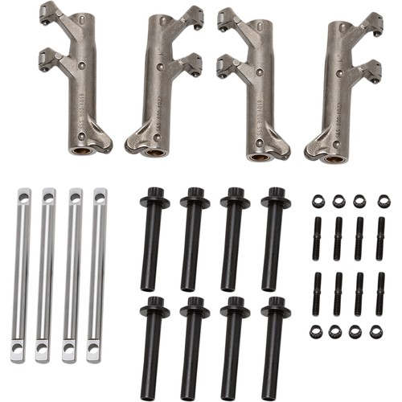

# Top End Guardian Kit

[All parts](../README.md) · [System](../systems/engine.md)

*Photo: Product/catalog image; inspect supplied hardware and finish against order description.*

| Field | Record |
| --- | --- |
| Status | Shipped |
| Quantity | 1  |
| Part number | 900-1092 |
| Part-number evidence | Catalog match to ordered description; order email does not print this SKU |
| Order / source | Parts Giant 2132153 |
| Order date | 2026-10-17 |
| Variant | 2018 FLHX fitment on order; shipped Oct19. |
| Documentation checked | 2026-10-23 |

## Product and installation documents

- [Product reference](https://www.partsgiant.com/p394294-s-and-s-top-end-guardian-kit)
- [Manufacturer product](https://www.sscycle.com/products/top-end-guardian-kit-for-2017-up-m8-models/)
- [S&S M8 rocker assembly, 510-0737A](https://www.sscycle.com/docs/default-source/instruction-sheets/510-0737a-m8-rocker-assembly.pdf?sfvrsn=2) — Manufacturer installation instructions
- [S&S M8 rocker-arm stud kit, 510-0683](https://www.sscycle.com/content/document_center/Instruction_Sheets/510-0683-m8-rocker-arm-stud-kit.pdf) — Manufacturer installation instructions
- [S&S M8 head bolts: 510-0662-m8-headbolts.pdf](https://www.sscycle.com/products/head-bolt-kit-for-2017-up-m8-models/) — Download listed in manufacturer product page

## Build notes

- 2018 FLHX fitment on order; shipped Oct19.
- These four component kits are expressly listed by S&S under 900-1092.
- The included 900-1006 head-bolt kit is also specified as required separately in the Power Pack listing; count the Guardian hardware toward this engine assembly.
- Guardian rocker studs, Guardian head bolts, and the separately ordered cylinder studs are three distinct component groups.

## Kit / assembly itemization

Components are grouped with this product. Separately indexed equipment and assembly references are not additional purchases. Read each row’s inclusion note.

| Included component | Quantity | Part number | Reference | Inclusion / identification note |
| --- | --- | --- | --- | --- |
| Forged roller rocker-arm set, 1.640:1 ratio | one set | 900-1084 | [Kit/manual parts reference](https://www.sscycle.com/products/s-s-forged-roller-rocker-arms-for-m8-models-1-640-1-ratio/) |  |
| Rocker-arm shaft set | one set | 900-1090 | [Kit/manual parts reference](https://www.sscycle.com/products/rocker-arm-shaft-set-for-2017-up-m8-models/) |  |
| Heavy-duty rocker-arm stud kit | one set | 900-1013 | [Kit/manual parts reference](https://www.sscycle.com/products/heavy-duty-stud-kit-for-rocker-arms-in-2017-up-m8-models/) |  |
| Head bolt kit | one set | 900-1006 | [Kit/manual parts reference](https://www.sscycle.com/products/head-bolt-kit-for-2017-up-m8-models/) |  |

**Kit documentation gap:** Some internal parts have only an illustrated kit/manual reference; separate retail listings or service SKUs were not verified. Do not treat a parent-kit link as a standalone component offer.

## Evidence

- Gmail message 1a1486e18d11946f; order reference Parts Giant 2132153
- Public source: https://www.partsgiant.com/p394294-s-and-s-top-end-guardian-kit
- Public source: https://www.sscycle.com/products/top-end-guardian-kit-for-2017-up-m8-models/
- Public source: https://www.sscycle.com/docs/default-source/instruction-sheets/510-0737a-m8-rocker-assembly.pdf?sfvrsn=2
- Public source: https://www.sscycle.com/content/document_center/Instruction_Sheets/510-0683-m8-rocker-arm-stud-kit.pdf
- Public source: https://www.sscycle.com/products/head-bolt-kit-for-2017-up-m8-models/
- Prior project inventory: Street_Glide_Master_Parts.xlsx, October 20, 2026, worksheet row 8.

## Builder record

- [ ] Received and box label matched
- [ ] Hardware and instructions present
- [ ] Installed / retained / superseded decision recorded
- [ ] Function checked

Installed date: __________  Technician: __________

Notes: ____________________________________________________
