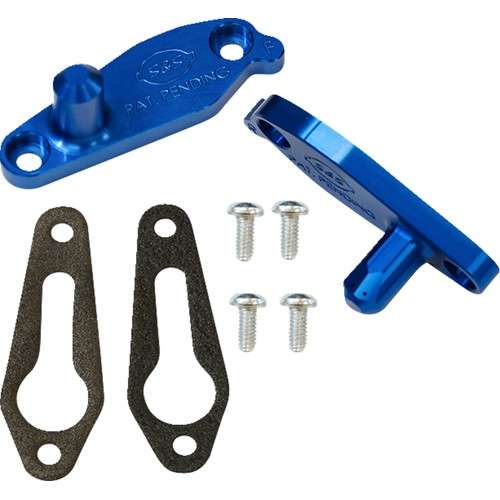

# Piston Cooling Jet Kit

[Home](../README.md) · [All parts A–Z](../PARTS_INDEX.md) · [System](../systems/engine.md)

*Photo: Product/catalog image; inspect supplied hardware and finish against order description.*

| Field | Record |
| --- | --- |
| Status | Shipped |
| Quantity | 1  |
| Part number | 310-1203 |
| Part-number evidence | Catalog match to ordered description; order email does not print this SKU |
| Order / source | Parts Giant 2132153 |
| Order date | 2026-10-17 |
| Variant | 2018 FLHX fitment on order; shipped Oct19. |
| Documentation checked | 2026-10-23 |

## Product and installation documents

- [Product reference](https://www.partsgiant.com/p420252-s-and-s-piston-cooling-jet-kit)
- [Manufacturer product](https://www.sscycle.com/products/piston-cooling-jet-kit-for-m-series-and-m8-engines/)
- [Prior inventory reference (may illustrate product family)](https://hobanbrothers.com/products/s-s-cycle-piston-cooling-jet-kit-for-m-series-and-m8-engines)
- [S&S 310-1203 piston cooling jet instructions, 510-0952](https://www.sscycle.com/content/document_center/Instruction_Sheets/510-0952-for-310-1203-m-series-piston-cooling-jet-_instruction-sheet.pdf) — Manufacturer installation instructions

## Build notes

- 2018 FLHX fitment on order; shipped Oct19.
- Install while the cylinders are removed; verify the spray-jet/piston relationship and fasteners using the supplied instructions.

## Kit / assembly itemization

Components are grouped with this product. Separately indexed equipment and assembly references are not additional purchases. Read each row’s inclusion note.

| Included component | Quantity | Part number | Reference | Inclusion / identification note |
| --- | --- | --- | --- | --- |
| Piston cooling jets | one set | Not published | [Parent product / kit reference](https://www.sscycle.com/products/piston-cooling-jet-kit-for-m-series-and-m8-engines/) | Individual jet sub-SKUs not verified. |
| Jet gaskets | one set | Not published | [Parent product / kit reference](https://www.sscycle.com/products/piston-cooling-jet-kit-for-m-series-and-m8-engines/) | Individual gasket SKU/count not independently verified. |
| Jet mounting hardware | one set | Not published | [Parent product / kit reference](https://www.sscycle.com/products/piston-cooling-jet-kit-for-m-series-and-m8-engines/) | Separate hardware SKUs not verified; reconcile actual packet with illustrated instructions. |

**Kit documentation gap:** Some internal parts have only an illustrated kit/manual reference; separate retail listings or service SKUs were not verified. Do not treat a parent-kit link as a standalone component offer.

## Evidence

- Gmail message 1a1486e18d11946f; order reference Parts Giant 2132153
- Public source: https://www.partsgiant.com/p420252-s-and-s-piston-cooling-jet-kit
- Public source: https://www.sscycle.com/products/piston-cooling-jet-kit-for-m-series-and-m8-engines/
- Public source: https://www.sscycle.com/content/document_center/Instruction_Sheets/510-0952-for-310-1203-m-series-piston-cooling-jet-_instruction-sheet.pdf
- Prior project inventory: Street_Glide_Master_Parts.xlsx, October 20, 2026, worksheet row 10.

## Builder record

- [ ] Received and box label matched
- [ ] Hardware and instructions present
- [ ] Installed / retained / superseded decision recorded
- [ ] Function checked

Installed date: __________  Technician: __________

Notes: ____________________________________________________
