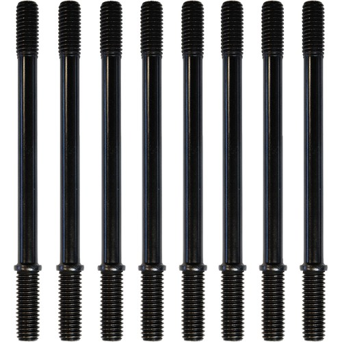

# Cylinder Stud Set 6.25"L Black 8-Pack

[All parts](../README.md) · [System](../systems/engine.md)

*Photo: Retailer family image: not evidence of exact stud length or thread. Confirm actual 6.250-inch M8 variant.*

| Field | Record |
| --- | --- |
| Status | Shipped |
| Quantity | 1  |
| Part number | 310-1204 |
| Part-number evidence | Catalog match to ordered description; order email does not print this SKU |
| Order / source | Parts Giant 2132153 |
| Order date | 2026-10-17 |
| Variant | 2018 FLHX fitment on order; shipped Oct19. |
| Documentation checked | 2026-10-23 |

## Product and installation documents

- [Product reference](https://www.partsgiant.com/p359397-s-and-s-cylinder-stud-set)
- [Manufacturer product](https://www.sscycle.com/products/cylinder-stud-kit-for-m8-models-8-pack/)
- [S&S cylinder stud instructions: 510-0975-instruction-shee-for-cylinder-stud-310-1172.pdf](https://www.sscycle.com/products/cylinder-stud-kit-for-m8-models-8-pack/) — Download listed on manufacturer M8 eight-pack product page; filename references component 310-1172

## Build notes

- 2018 FLHX fitment on order; shipped Oct19.
- Order specifically says 6.25-inch length and eight-pack. PartsGiant generic selector may open on a different length; use the ordered variant and manufacturer M8 page.
- These are cylinder-to-crankcase studs, distinct from the Guardian rocker studs and head bolts.

## Kit / assembly itemization

Components are grouped with this product. Separately indexed equipment and assembly references are not additional purchases. Read each row’s inclusion note.

| Included component | Quantity | Part number | Reference | Inclusion / identification note |
| --- | --- | --- | --- | --- |
| Black steel M8 cylinder studs, 7/16-14 UNC × 6.250 inches | 8 | 310-1204 | [Parent product / kit reference](https://www.sscycle.com/products/cylinder-stud-kit-for-m8-models-8-pack/) | 310-1204 is the eight-pack SKU; separate single-stud retail SKU not verified. |

**Kit documentation gap:** Some internal parts have only an illustrated kit/manual reference; separate retail listings or service SKUs were not verified. Do not treat a parent-kit link as a standalone component offer.

## Evidence

- Gmail message 1a1486e18d11946f; order reference Parts Giant 2132153
- Public source: https://www.partsgiant.com/p359397-s-and-s-cylinder-stud-set
- Public source: https://www.sscycle.com/products/cylinder-stud-kit-for-m8-models-8-pack/
- Prior project inventory: Street_Glide_Master_Parts.xlsx, October 20, 2026, worksheet row 11.

## Builder record

- [ ] Received and box label matched
- [ ] Hardware and instructions present
- [ ] Installed / retained / superseded decision recorded
- [ ] Function checked

Installed date: __________  Technician: __________

Notes: ____________________________________________________
